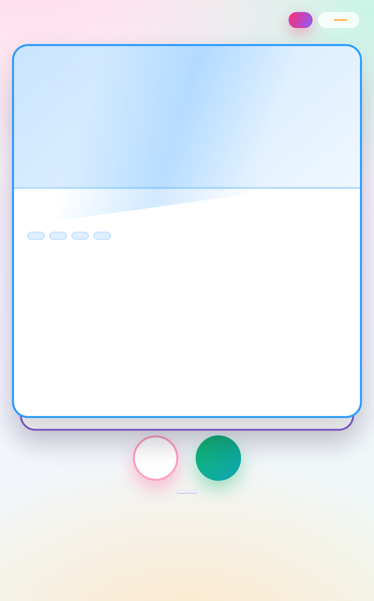
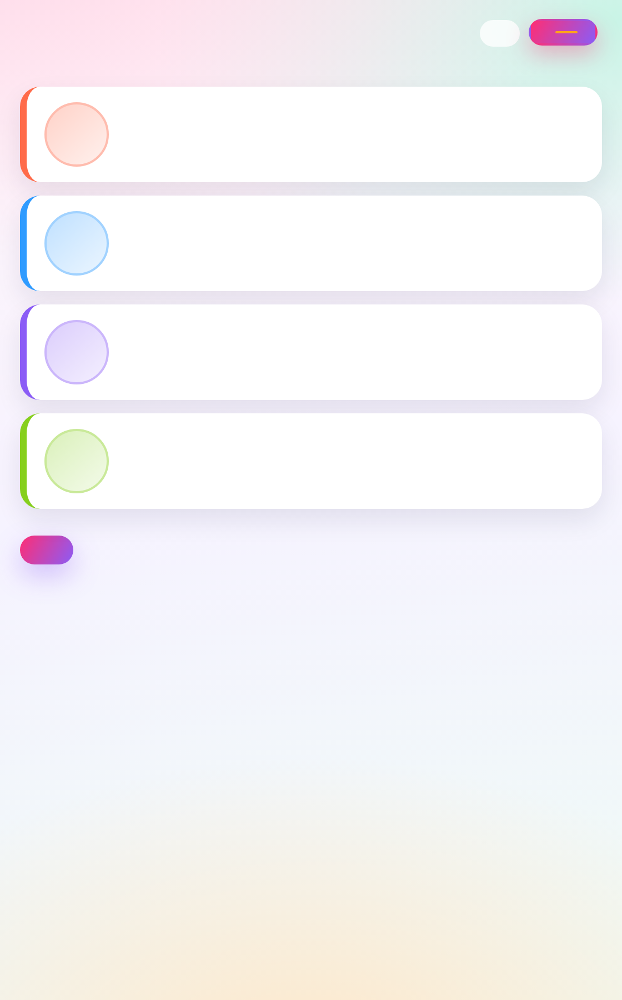
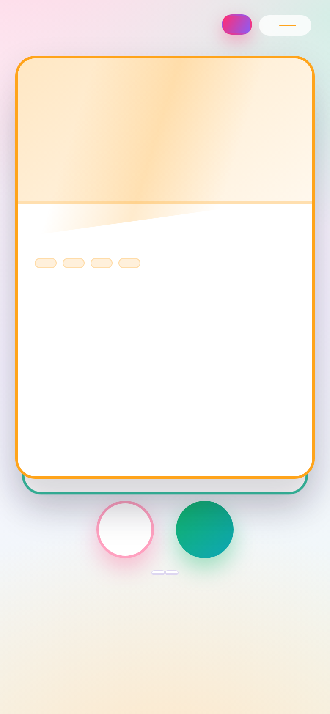

# 🐼 Panda Tinder

A swipe-to-match dating site where every profile is a panda. No dependencies, no build step, no framework — plain HTML, CSS and ES modules.



## What it does

- **Swipe view** — one panda at a time with emoji art, name, age, location, a tagline, a bio and hashtagged interests. Swipe right (♥) to like, left (✕) to pass, using the buttons, your keyboard (<kbd>→</kbd> / <kbd>←</kbd>), or by dragging the card. Dragging fades in a LIKE/NOPE stamp that tilts as you pull.
- **Matches view** — everyone you liked, ranked by how well you'd actually get on, with a match percentage. A badge on the tab keeps count.
- **8 pandas** with names like Bamboo Bae, Kung Fu Ling, Mister Nap and Nutmeg (who insists she's a red panda).
- **Per-panda accent colours** — the card border, art band, age, interest chips, match row and score all derive from one accent per panda.
- Progress is saved in `localStorage`, so a reload keeps your place. **Reset the deck** reshuffles and starts over.

| Swiping right | Matches |
| --- | --- |
|  |  |

<p align="center">
  
</p>

## Run it

```bash
npm start        # then open http://localhost:3000
```

Or just open `index.html` directly — it is entirely client-side, so no server is needed.

## Test it

```bash
npm test
```

19 tests, using Node's built-in test runner. No test dependencies.

## How it works

`src/pandas.js` holds the roster and all the logic — match scoring, a seeded shuffle and the swipe state machine — with **no DOM and no storage access**. That separation is what makes it directly testable. `src/app.js` does rendering, gestures and persistence.

### Match score

`matchScore(a, b)` is the Jaccard overlap of two pandas' likes, minus a penalty for a wide age gap, scaled to 0–100. It is deterministic and symmetric: pandas who both love bamboo and napping score high, and a 3-year-old and a 23-year-old with identical interests score lower.

```js
matchScore(a, b) === matchScore(b, a)   // always
matchScore(p, p) >= matchScore(p, any)  // a panda matches itself highest
```

### Accents

Accents live on the panda as data, with an `accentFor()` helper that falls back to a stable colour hashed from the id — so a panda added without an accent still gets one rather than rendering colourless. The palette keys are `mint`, `violet`, `sky`, `amber`, `coral`, `teal`, `lime` and `pink`.

The styling uses modern CSS: `color-mix()` and custom properties. On a very old browser the tinted chips and bands would lose their tint, but the layout and the accent borders would survive.

## Files

| Path | What it is |
| --- | --- |
| `index.html` | The two views |
| `styles.css` | Palette, layout and animations (all CSS, no JS animation loop) |
| `src/pandas.js` | Roster + logic: match score, seeded shuffle, swipe state machine |
| `src/app.js` | Rendering, drag/keyboard swiping, storage |
| `test/pandas.test.js` | 19 unit tests |
| `server.js` | Tiny static server for local runs |
| `docs/` | Screenshots |

## Deploying

The site is live at **https://vymalo.github.io/panda-tinder**.

`.github/workflows/pages.yml` publishes it on every push to `main`. Enable it once under **Settings → Pages → Source: GitHub Actions**.

Pages on a **private** repository requires a paid plan; this repository is public, so it is free. The files could equally be hosted anywhere that serves static files — there is nothing to build.

### Workflow action versions

The pins in the workflow were checked against the upstream releases rather than assumed:

| Action | Pinned | Latest |
| --- | --- | --- |
| `actions/checkout` | `v7` | v7.0.1 |
| `actions/setup-node` | `v7` | v7.1.0 |
| `actions/configure-pages` | `v6` | v6.0.0 |
| `actions/upload-pages-artifact` | `v5` | v5.0.0 |
| `actions/deploy-pages` | `v5` | v5.0.1 |

These are moving major tags, so a patch release is picked up automatically.

`node-version` is pinned to `'24'`. Node 24 is the Active LTS line, but note that its active support ends **20 October 2026**, after which it moves to maintenance until 30 April 2028. Node 26 becomes LTS on **28 October 2026**; moving to it is a one-line change once the toolchain you use locally has caught up.
